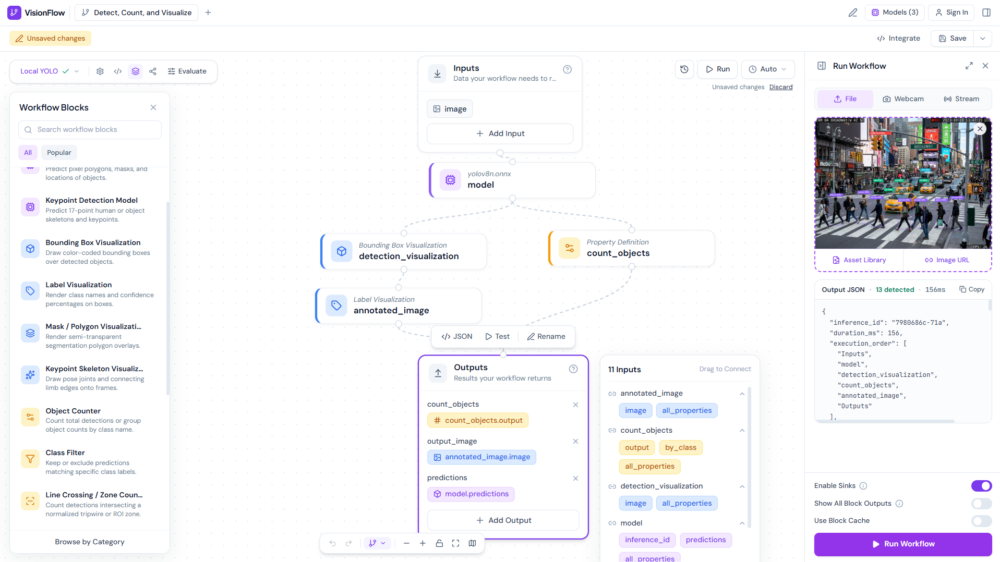
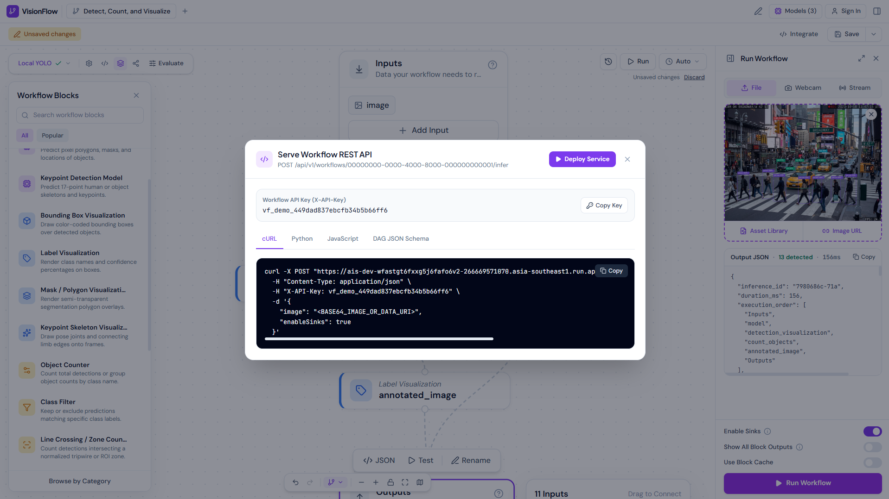
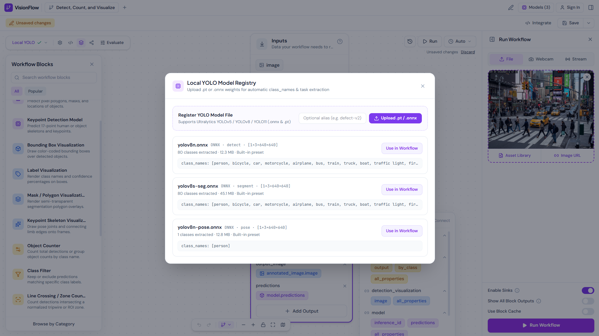

<div align="center">

# VisionFlow

**Node-Based Computer Vision Workflow Builder & Local YOLO Inference Server**

Design directed acyclic vision pipelines visually, inspect `.onnx` / `.pt` YOLO weights, run real-time local inference on images, webcams, or RTSP streams, and deploy every graph instantly as a production REST API & MJPEG stream service.

<p>
  
  
  
  
  
  
  
</p>

</div>

---

## Visual Overview

<p align="center">
  
</p>

<table>
  <tr>
    <td width="50%" align="center">
      
      <br />
      <sub><strong>Instant REST API Serving</strong> — cURL, Python, JavaScript &amp; DAG JSON export with scoped <code>X-API-Key</code></sub>
    </td>
    <td width="50%" align="center">
      
      <br />
      <sub><strong>Local YOLO Model Registry</strong> — Upload <code>.onnx</code> / <code>.pt</code> weights with automatic class &amp; task extraction</sub>
    </td>
  </tr>
</table>

---

## Key Capabilities

- **Visual Top-to-Bottom DAG Editor:** Drag, connect, rename, duplicate, disable, and inspect nodes with inline floating `Inputs` / `Outputs` field mapping (`inputs.image` → `model.predictions` → `annotated_image.image` → `outputs`).
- **Local YOLO Model Registry:** Upload `.onnx` and `.pt` models with automated `class_names`, tensor `inputShape`, and task (`detect`, `segment`, `pose`) inspection persisted to PostgreSQL.
- **Deterministic Topological DAG Engine:** Executes graphs via Kahn's topological sort using `onnxruntime-node` for inference and `sharp` SVG compositing for bounding boxes, labels, segmentation polygons, and pose keypoints.
- **Logic & Automation Blocks:** Built-in `Object Counter`, `Class Filter`, `Line Crossing / Zone Counter`, `Condition (if count > N)`, and output sinks (`Webhook`, `MQTT`, `Modbus`).
- **Interactive Run & Test Panel:** Test workflows live against uploaded image files, public HTTPS URLs, browser **Webcam** frames, or background **RTSP/HTTP** video workers via `ffmpeg` with live MJPEG preview.
- **One-Click API Deployment:** Every saved workflow exposes `POST /api/v1/workflows/:workflowId/infer` secured by per-workflow `X-API-Key` or JWT Bearer auth, logging execution metrics to `inference_runs`.

---

## Project Structure

```text
visionflow/
├── docs/                              # Repository documentation screenshots
│   ├── screen_vision_flow_main.png    # Main 3-column DAG builder & live inference view
│   ├── screen_vision_flow_2.png       # Serve Workflow REST API modal
│   └── screen_vision_flow_3.png       # Local YOLO Model Registry modal
├── server/                            # Backend inference, DAG, auth, and worker modules
│   ├── auth.ts                        # bcryptjs password hashing, JWT auth, SSRF URL validator
│   ├── dagEngine.ts                   # Kahn topological sort & node-by-node DAG runner
│   ├── modelInspector.ts              # .onnx (onnxruntime-node/protobuf) & .pt (pickletools) metadata extractor
│   ├── store.ts                       # Drizzle ORM repository & startup PostgreSQL seeding
│   ├── streamWorker.ts                # Background RTSP/HTTP ffmpeg frame loop & MJPEG/sink dispatcher
│   └── yoloEngine.ts                  # Real ONNX YOLO pre/post-processing, NMS & sharp SVG overlays
├── src/
│   ├── components/
│   │   ├── Modals.tsx                 # Model Registry, API Integration, Auth, Node JSON & Run History modals
│   │   ├── RunWorkflowPanel.tsx       # Right panel: File, Webcam, and RTSP Stream test & output JSON viewer
│   │   ├── WorkflowBlocksSidebar.tsx  # Left floating block palette with category drill-down & search
│   │   └── WorkflowNodes.tsx          # Custom React Flow Inputs, Step, Outputs nodes & dashed Bezier edges
│   ├── db/
│   │   ├── index.ts                   # Split DB_* PostgreSQL pool & idempotent DDL table bootstrap
│   │   └── schema.ts                  # Drizzle schema (users, models, workflows, streams, inference_runs)
│   ├── lib/
│   │   └── api.ts                     # Typed frontend HTTP client with in-memory JWT Bearer session
│   ├── shared/
│   │   └── workflowSchema.ts          # Standard DAG JSON schema, block specs & default workflow factory
│   ├── types/
│   │   └── visionflow.ts              # Shared UI TypeScript interfaces
│   ├── App.tsx                        # Main workspace orchestrator, undo/redo, auto-layout & React Flow state
│   ├── index.css                      # Tailwind v4 stylesheet & light-theme React Flow canvas tokens
│   └── main.tsx                       # React 19 entry point
├── uploads/
│   └── models/
│       └── yolov8n.onnx               # Local YOLOv8n ONNX weights seeded into Model Registry
├── server.ts                          # Express HTTP/API server & Vite dev/static middleware entry point
├── .env.example                       # Environment variable template (split DB_* & app settings)
├── package.json
├── tsconfig.json
└── vite.config.ts
```

---

## Apps System Architecture

```text
┌───────────────────────────────────────────────────────────────────────────────┐
│                         Frontend SPA (React 19 + Vite)                        │
│                                                                               │
│  ┌──────────────────────┐  ┌───────────────────────┐  ┌────────────────────┐  │
│  │ WorkflowBlocksSidebar│  │ React Flow DAG Canvas │  │  RunWorkflowPanel  │  │
│  │  (Catalog & Drag)    │─▶│ (Nodes, Edges, Map)   │─▶│ (File/Cam/Stream)  │  │
│  └──────────────────────┘  └───────────────────────┘  └─────────┬──────────┘  │
└─────────────────────────────────────────────────────────────────┼─────────────┘
                                                                  │ REST / Multipart / MJPEG
                                                                  ▼
┌───────────────────────────────────────────────────────────────────────────────┐
│                      Express API & Serving Gateway (server.ts)                │
│                                                                               │
│  • Auth Middleware (JWT + bcryptjs)       • /api/models/upload (Multer)       │
│  • /api/workflows & /deploy               • /api/v1/workflows/:id/infer       │
│  • /api/workflows/run                     • /api/streams/:id/{start,stop,mjpeg}│
└───────────────┬─────────────────────────────────────────┬─────────────────────┘
                │                                         │
                ▼                                         ▼
┌───────────────────────────────────┐     ┌─────────────────────────────────────┐
│       DAG & Inference Core        │     │      Background Stream Workers      │
│                                   │     │                                     │
│  dagEngine.ts (Topological Sort)  │     │  streamWorker.ts                    │
│   ├─▶ yoloEngine.ts               │     │   ├─▶ ffmpeg RTSP/HTTP capture      │
│   │    ├─▶ onnxruntime-node       │     │   ├─▶ executeWorkflowDag()          │
│   │    └─▶ sharp SVG compositor   │     │   └─▶ MJPEG / Webhook / MQTT / Modbus│
│   └─▶ Logic, Zone & Sink Nodes    │     │                                     │
└───────────────┬───────────────────┘     └──────────────────┬──────────────────┘
                │                                            │
                └─────────────────────┬──────────────────────┘
                                      ▼
                     ┌─────────────────────────────────┐
                     │    PostgreSQL + Drizzle ORM     │
                     │                                 │
                     │  • users         • workflows    │
                     │  • models        • streams      │
                     │  • inference_runs               │
                     └─────────────────────────────────┘
```

### Execution Flow

1. **Schema & Authoring:** Every workflow graph conforms to `WorkflowDefinition` (`inputs`, `nodes`, `edges`, `outputs`) and is persisted as JSONB in PostgreSQL (`workflows`).
2. **Model Inspection:** When uploading `.onnx` or `.pt` weights, `modelInspector.ts` extracts `class_names`, tensor `inputShape`, and task type (`detect` / `segment` / `pose`) before writing to the `models` table.
3. **Topological Execution:** `dagEngine.ts` builds an adjacency graph, rejects cycles via Kahn's algorithm, resolves `$inputs` / upstream node output references (`model.predictions`, `detection_visualization.image`), runs real ONNX tensor inference in `yoloEngine.ts`, composites annotated JPEG frames with `sharp`, and logs latency/counts to `inference_runs`.
4. **Live Serving:** Deployed workflows expose `POST /api/v1/workflows/:workflowId/infer` accepting `multipart/form-data`, base64 payloads, or validated public HTTPS `image_url`, returning structured JSON + base64 annotated output.

---

## Tech Stack

| Layer | Technology | Purpose |
| :--- | :--- | :--- |
| **Frontend UI** | React 19, TypeScript, Tailwind CSS v4, Lucide Icons | 3-column workspace, modals, responsive test runner |
| **Node Editor** | `@xyflow/react` v13 | Custom DAG nodes, dashed Bezier connectors, auto-layout, minimap |
| **Inference Engine** | `onnxruntime-node`, `sharp` | Local CPU YOLO inference (detect/segment/pose), NMS & SVG image annotation |
| **Model Parsing** | `adm-zip`, Python stdlib `pickletools` | `.onnx` metadata/protobuf scan and `.pt` PyTorch zip header inspection |
| **Backend API** | Express 4, Multer, Zod | REST endpoints, file uploads, request validation, SSRF-safe URL fetching |
| **Authentication** | `jsonwebtoken`, `bcryptjs` | Password hashing, JWT Bearer sessions, per-workflow `X-API-Key` |
| **Database & ORM** | PostgreSQL, Drizzle ORM, `postgres` | Persistent storage for users, models, workflows, streams, and run history |
| **Stream Processing** | `ffmpeg` (child process) | RTSP / HTTP live frame extraction & real-time MJPEG multipart streaming |

---

## How to Build

### 1. Prerequisites

- **Node.js** `>= 20.x` (tested on Node `v22`)
- **PostgreSQL** `>= 14` (e.g., Supabase, Neon, RDS, or local Postgres)
- **FFmpeg** installed on `PATH` (required only for live RTSP/HTTP stream workers)
- **Python 3** stdlib (optional, used by `modelInspector.ts` to safely inspect `.pt` pickle headers without executing pickle code)

### 2. Install Dependencies

```bash
npm install
```

### 3. Configure Environment Variables

Copy `.env.example` to `.env` (or configure environment variables in your host/secrets manager):

```env
PORT=3000
JWT_SECRET="replace-with-a-strong-random-secret"

# PostgreSQL connection parameters (Drizzle ORM)
DB_HOST=your-postgres-host
DB_PORT=5432
DB_NAME=postgres
DB_USER=postgres
DB_PASSWORD=your-postgres-password
```

> On startup, `src/db/index.ts` automatically bootstraps the required tables (`users`, `models`, `workflows`, `streams`, `inference_runs`) and `seedDatabaseDefaults()` registers `uploads/models/yolov8n.onnx` plus the default **Detect, Count, and Visualize** workflow if the database is empty.

### 4. Development, Typecheck & Production Build

```bash
# Run development server (Express API + Vite middleware on port 3000)
npm run dev

# Run TypeScript typechecking
npm run lint

# Build the production frontend bundle into dist/
npm run build
```

---

## How to Deploy

### Option A: Node.js Full-Stack Server (VM / Cloud Run / Render / Railway)

1. Ensure `uploads/models/yolov8n.onnx` (and any persisted `uploads/` volume) plus `ffmpeg` are available in the runtime container.
2. Build the client assets and start the Express server in production mode:

```bash
npm ci
npm run build
NODE_ENV=production npm start
```

> `package.json` configures `"start": "node server.ts"` (supported natively on Node 22+ with TypeScript stripping, or run via `npx tsx server.ts`). Ensure the service listens on port `3000` (or route external HTTP traffic to container port `3000`).

### Option B: Calling Deployed Workflow Inference Endpoints

Once a workflow is saved or deployed from the **Integrate** modal, invoke its inference endpoint from any external service:

```bash
curl -X POST "https://<your-domain>/api/v1/workflows/<workflow_id>/infer" \
  -H "Content-Type: application/json" \
  -H "X-API-Key: <workflow_api_key>" \
  -d '{
    "image": "<BASE64_IMAGE_OR_DATA_URI>",
    "enableSinks": true
  }'
```

### Git Remote Hygiene

Temporary AI Studio attachment assets under `public/assets/aistudio/` are ignored in `.gitignore`. If they were previously committed to an existing git repository, untrack them before pushing:

```bash
git rm -r --cached public/assets/aistudio
git commit -m "chore: stop tracking public/assets/aistudio and move docs screenshots"
```
